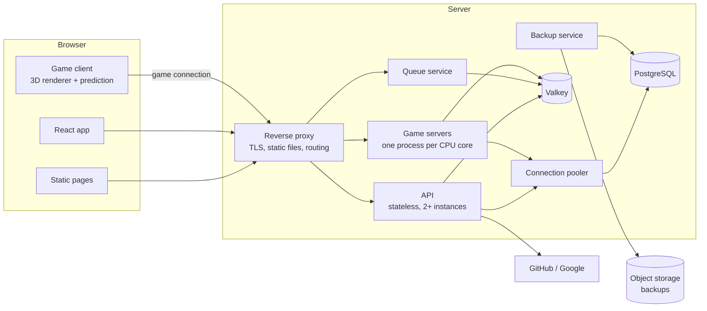
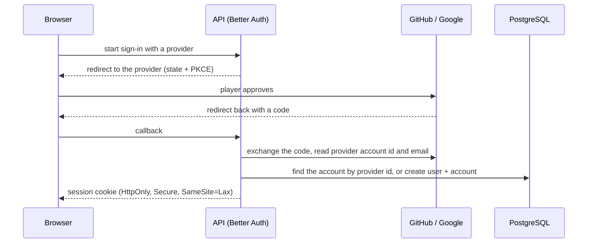
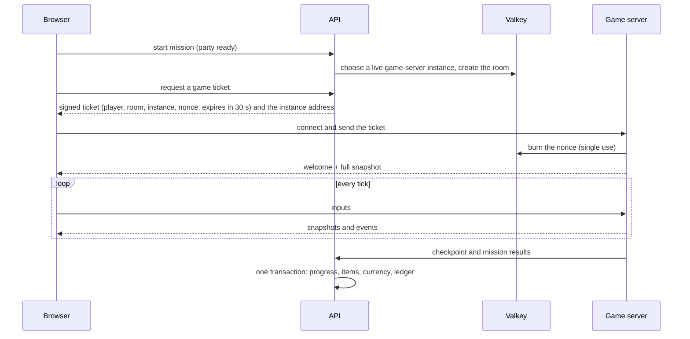

# Architecture

Rotline is a browser game with an authoritative game server. The browser sends inputs and draws what the server decides; everything that matters (damage, kills, drops, XP, currency, purchases, contract progress) is decided on the server.

## Repository layout

```
apps/
  web/            Static pages (landing, privacy, terms, queue) and the React app (lobby, armory, shop, friends, settings, admin, HUD)
  api/            HTTP API: sign-in, profile, inventory, shop, ledger, friends, lobbies, matchmaking, admin
  game-server/    Authoritative room server with a fixed 30 Hz simulation tick
  queue/          Small admission service: seat count, queue positions, admission passes
packages/
  sim/            Engine-free game simulation, run by the game server and by the browser for prediction
  client/         3D renderer, input, prediction and interpolation, audio
  game-data/      Weapons, zombies, skills, missions, contracts and prices as validated data files
  protocol/       Message definitions and the binary encoder and decoder
  db/             Database schema, migrations, queries, ledger functions
  ui/             Shared interface components in the Rotline style
tooling/
  biome/          Shared lint and format presets
  typescript/     Shared TypeScript presets
brand/            Logo, icons, colours, fonts
docs/             This documentation
.claude/          Claude Code skills and helper agents
.github/          CI workflows
```

Server provisioning and production deployment configuration are kept outside this repository.

## Services



| Service | Responsibility | State |
|---|---|---|
| Reverse proxy | TLS, static files with long cache headers, routing to API, queue and game servers | none |
| API | Accounts, sessions, profile, inventory, shop, ledger, friends, lobbies, matchmaking, admin | none (stateless) |
| Queue | Seats, queue positions, admission passes | Valkey |
| Game servers | Rooms, simulation, snapshots, mission results | in memory; results written through the API |
| PostgreSQL | All persistent data | disk |
| Valkey | Presence, queue, seats, room registry, rate limits, messages between instances, game tickets | memory with append-only persistence; rebuildable |
| Backup service | Continuous point-in-time backups and a daily logical dump to object storage | — |

All services take their configuration from environment variables. Only PostgreSQL and Valkey keep data on disk. Players cannot upload anything.

## Sign-in

Players sign in with GitHub or Google through Better Auth. There are no passwords and no guest accounts.



- An account is identified by the provider's account id, never by email alone.
- A second provider is linked only by a signed-in player from the settings page. Signing in with a new provider whose email matches an existing account does not merge them automatically.
- From the provider we keep the provider account id and the email. No profile photo, real name or long-lived provider tokens are stored.
- New players choose a unique player name (checked against a profanity and impersonation filter) and a generated avatar (style + seed; no images are stored).

## Seats and the queue

The game admits a set number of concurrent players (an admin setting, 24 by default). A concurrent player is a signed-in player connected to the lobby, the firing range or a mission.

```mermaid
sequenceDiagram
  participant B as Browser
  participant Q as Queue service
  participant V as Valkey
  B->>Q: enter (session)
  Q->>V: seats used < capacity?
  alt seat free
    Q->>V: take a seat
    Q-->>B: admitted, go to the lobby
  else full
    Q->>V: add to the queue (join time, party size)
    Q-->>B: position and estimated wait
    Q-->>B: live updates while waiting
    Note over Q,V: when a seat frees, the first entry gets a 90-second admission pass;<br/>a party is admitted when enough seats are free for all of it
    Q-->>B: admitted
  end
```

- First come, first served. Parties queue together.
- Connected players keep their seat; a player who disconnects mid-mission keeps it for the reconnect grace period.
- Players idle in the lobby are warned and then lose their seat.
- Effective capacity lowers itself when server health degrades (slow ticks), and recovers when healthy. Lowering never removes anyone; it only stops admitting.
- The queue page is a small static page that keeps working when game servers are busy. It shows the position, an estimated wait, friends online, tips and bestiary entries.

## Joining a match



- Tickets are signed with Ed25519 by the API and verified by the game server with the public key, with no database call.
- Mission progress is held in memory and saved at checkpoints and at mission end. Each save is one transaction with a unique grant key, so a retried save cannot pay twice. A mission in progress can be lost in a crash; anything saved cannot.

## Squads

Every signed-in player is in a squad (party) of one to four, kept in Valkey: members in join order, the leader, a six-character code, who is ready, and whether the squad is in a mission.

- Players join by code or by an invite link (`/play/lobby?join=CODE`). Squad changes are atomic Lua scripts, so several API instances can change the same squad safely.
- The leader deploys once everyone else is ready. The API picks the least busy live game-server instance from the registry, names a room and marks the squad as in a mission; every member then asks for their own ticket to that room.
- Game servers refresh their instance record every five seconds and each room's record every second. A squad whose room record has expired goes back to the lobby.
- Changes are pushed to members through the event stream (below), so lobbies update at once.

## Event stream

Each open app tab keeps one Server-Sent Events connection to the API (`/api/events`). The API subscribes to the player's Valkey channel while the stream is open and forwards events (squad changed, invites, presence). The browser reconnects by itself and refreshes what it shows after each reconnect.

## Presence and friends

Game servers and the API keep each player's presence (lobby, mission name, queue, firing range, offline) in Valkey and publish every change. Each client has one push channel and receives changes only for its friends. Nothing polls.

## Game client and interface

- The landing page is static HTML and ships no game code.
- Clicking Play loads the React app; the 3D engine and game assets load only when entering the lobby.
- The game client writes HUD state (health, ammo, cooldowns, multiplier, objectives) into a small store. React components subscribe to it and update at most 15 times per second, so React never runs inside the render loop.
- Rendering is real 3D with a fixed, nearly top-down camera. Zombies are drawn as instanced meshes with their animations baked into GPU textures, so hundreds of them cost a handful of draw calls.

## Deploys without dropping matches

- New game-server processes start beside the old ones and register in the room registry.
- Old processes are marked as draining: they take no new rooms and exit when their last room ends.
- API instances are replaced one at a time after their health check passes.
- Database migrations run before new code starts and are backward compatible (add first, remove later), so rolling back never breaks the database.

## Scaling out

Nothing in the design assumes a single machine:

- PostgreSQL and Valkey are reached through connection strings, so they can move to their own machine with a configuration change.
- Game servers register their own public address in the room registry; adding a machine (in any region) adds capacity.
- The API and the reverse proxy are stateless and can run as several instances.
