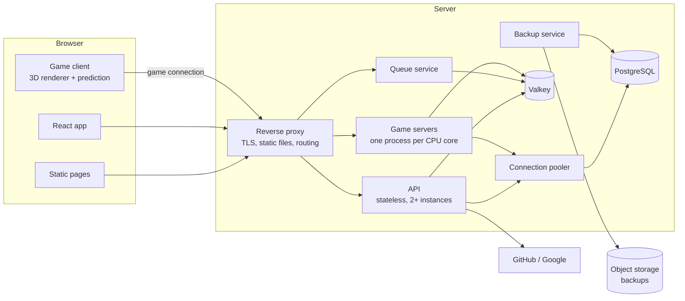
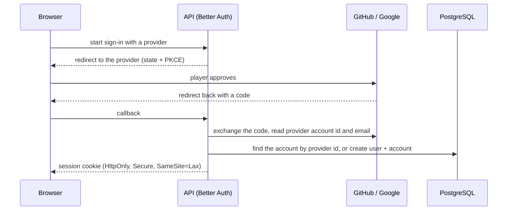
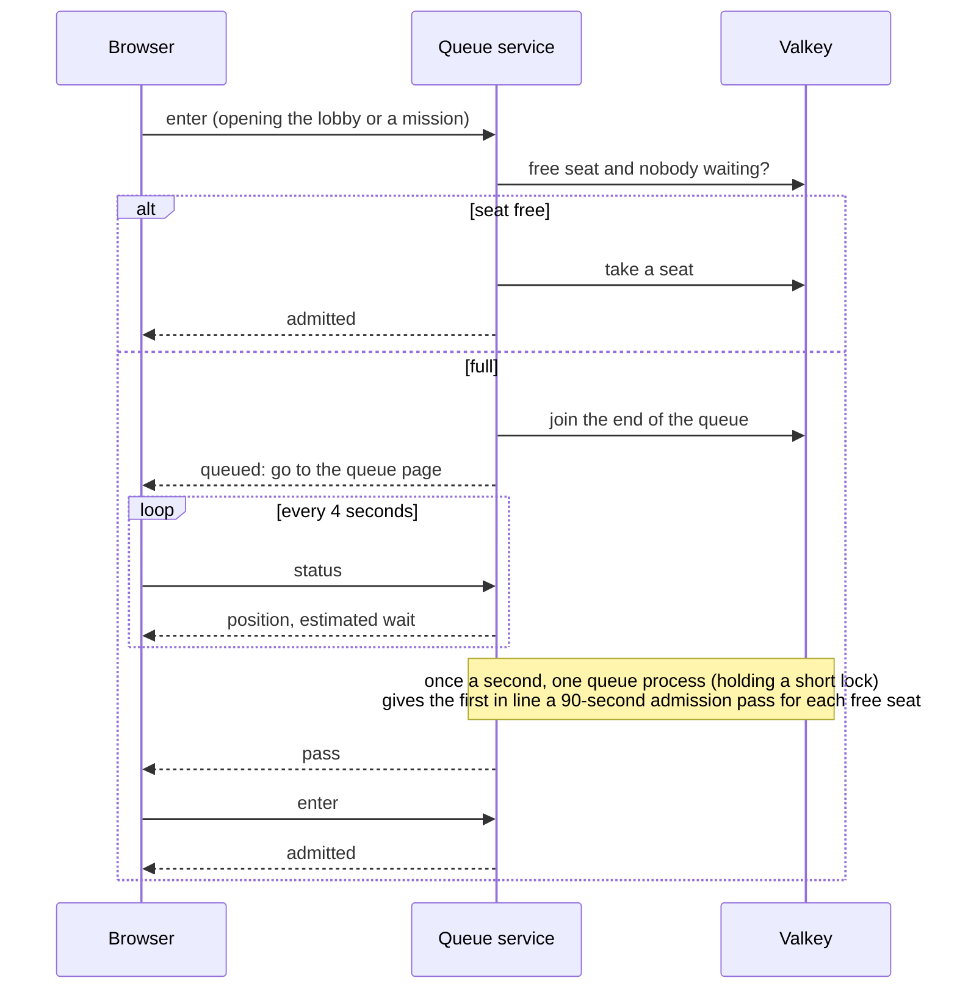
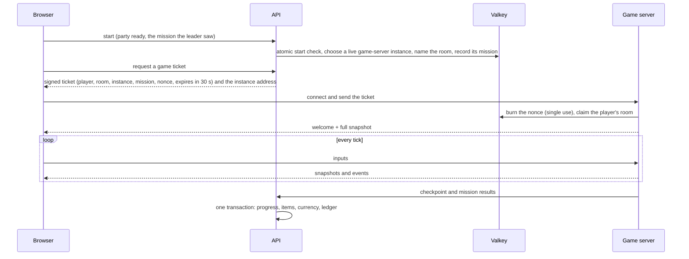

# Architecture

Rotline is a browser game with an authoritative game server. The browser sends inputs and draws what the server decides; everything that matters (damage, kills, drops, XP, currency, purchases, contract progress) is decided on the server.

## Repository layout

```
apps/
  web/            Static pages (landing, privacy, terms, queue) and the React app (lobby, armory, shop, friends, settings, admin, HUD)
  api/            HTTP API: sign-in, profile, inventory, shop, ledger, friends, lobbies, matchmaking, admin
  game-server/    Authoritative room server with a fixed 30 Hz simulation tick
  queue/          Small admission service: seat count, queue positions, admission passes
packages/
  sim/            Engine-free game simulation, run by the game server and by the browser for prediction
  client/         3D renderer, input, prediction and interpolation, audio
  game-data/      Weapons, zombies, skills, missions, contracts and prices as validated data files
  protocol/       Message definitions and the binary encoder and decoder
  db/             Database schema, migrations, queries, ledger functions
  ui/             Shared interface components in the Rotline style
tooling/
  biome/          Shared lint and format presets
  typescript/     Shared TypeScript presets
brand/            Logo, icons, colours, fonts
docs/             This documentation
.claude/          Claude Code skills and helper agents
.github/          CI workflows
```

Server provisioning and production deployment configuration are kept outside this repository.

## Services



| Service | Responsibility | State |
|---|---|---|
| Reverse proxy | TLS, static files with long cache headers, routing to API, queue and game servers | none |
| API | Accounts, sessions, profile, inventory, shop, ledger, friends, lobbies, matchmaking, admin | none (stateless) |
| Queue | Seats, queue positions, admission passes | Valkey |
| Game servers | Rooms, simulation, snapshots, mission results | in memory; results written through the API |
| PostgreSQL | All persistent data | disk |
| Valkey | Presence, queue, seats, room registry (with each room's mission and each player's current room), rate limits, messages between instances, game tickets, the reward stream, short cooldowns after abandoning a mission | memory with append-only persistence; rebuildable |
| Backup service | Continuous point-in-time backups and a daily logical dump to object storage | — |

All services take their configuration from environment variables. Only PostgreSQL and Valkey keep data on disk. Players cannot upload anything.

## Sign-in

Players sign in with GitHub or Google through Better Auth. There are no passwords and no guest accounts.



- An account is identified by the provider's account id, never by email alone.
- A second provider is linked only by a signed-in player from the settings page. Signing in with a new provider whose email matches an existing account does not merge them automatically.
- From the provider we keep the provider account id and the email. No profile photo, real name or long-lived provider tokens are stored.
- New players choose a unique player name (checked against a profanity and impersonation filter) and a generated avatar (style + seed; no images are stored).

## Seats and the queue

The game admits a set number of concurrent players (an admin setting, 24 by default). A concurrent player is a signed-in player with the lobby, the firing range or a mission open. The queue service (`apps/queue`) owns seats; it is small and separate from the API so the queue keeps answering when everything else is busy.



- First come, first served: queue order is a counter, not the clock. Players queue one by one; squads form in the lobby once admitted.
- A seat is kept by a heartbeat from the open app every 30 seconds and lapses 120 seconds after the last one (the reconnect grace). Signing out frees it at once.
- An unused pass counts as a taken seat until it expires. A queued player whose page stops asking for 30 seconds (tab closed) leaves the line.
- The heartbeat carries how long the player has been idle: at 10 minutes the app warns, at 12 the seat is released and the player goes to the queue page.
- The API hands out game tickets only to players holding a seat.
- Game servers publish their slowest recent tick and the share of ticks over 20 ms in the last five seconds. While more than 5 % of any server's ticks run over (sustained load, not one garbage collection or a room starting), the effective capacity drops by 10 % a minute (never below half); when healthy it recovers by one seat a minute. Lowering never removes anyone; it only stops admitting.
- The app checks the seat when a lobby screen opens, but not on a hover that only preloads a screen, not again within a minute of a confirmed seat (heartbeats confirm it too), and never sends a player to the queue on a failed or refused check: only a definite "queued" does. The API checks the seat again before any game ticket.
- The capacity is stored in the database (`admin_setting`) and mirrored into Valkey when the API starts and whenever an admin changes it.
- The queue page is static (`/queue`): position, estimated wait (from how fast seats recently turned over), players in the game, friends online, rotating tips and bestiary entries, an optional browser notification and a sound when the pass arrives, and a countdown to use it.

## Joining a match



- Tickets are signed with Ed25519 by the API and verified by the game server with the public key, with no database call.
- The ticket also carries the player's **build**: class, class level, skill ranks, equipped abilities, and the loadout with each item's upgrade level and perks. The game server turns it into stats with the same game-data code the API and the browser use, and repeats it in the welcome message so client prediction uses exactly the server's numbers. The build is fixed for the mission: class, skills, loadout and upgrades cannot change while the squad is in one.
- A squad ticket also names the mission and difficulty, or for Survival the arena (its map) the leader chose. Every ticket to a room must name the same mode, mission and arena the room was created with, and a game server refuses a mission or arena its game data does not know. A contract with several maps runs on the one its room id picks (a hash of the random id into the contract's maps), so the API, the game server and every player's browser agree on it without storing it anywhere. Once a room is finished, only its own players may come back to it (to see their results).
- The welcome message also carries a fingerprint of the game data the server runs (maps, props, missions, zombies, weapons, the campaign). A client built from other data stops and asks the player to reload, because its map props and prediction would not match the server's.
- Mission progress is held in memory and saved at checkpoints and at mission end. Each save is one transaction with a unique grant key, so a retried save cannot pay twice. A mission in progress can be lost in a crash; anything saved cannot.

## Rewards

```mermaid
sequenceDiagram
  participant G as Game server
  participant V as Valkey (stream "rewards")
  participant A as API
  participant D as PostgreSQL
  G->>V: XADD report (grant key, player, class, XP, Salvage, items found, mission result)
  A->>V: XREADGROUP (consumer group shared by all API instances)
  A->>V: read the room's recorded mission
  A->>D: one transaction: reward_grant row, items, mission record, class XP, ledger row, balance
  A->>V: XACK; notify the player (progress changed)
```

- A room adds up what each player earns (XP and Salvage per kill, objective, optional objective and completion rewards and score converted to XP and Salvage, all from game data and scaled by the difficulty; a bonus per Survival round cleared) and reports it at every round cleared, at every checkpoint, at mission end, when the player's reconnect grace runs out, when the room closes and on shutdown. Fractions carry over to the next report. Items found travel only with checkpoint and mission-end reports; the mission result only with the mission-end report.
- A report larger than one report may carry (`maxPerReport` in game data) is split into several, and the items and the result go with the last part.
- Each report's grant key (`room:player:membership:sequence`) is recorded in the same transaction as the XP and Salvage, so a report delivered twice pays once. Reports are acknowledged only after their transaction commits; one an API instance was holding when it died is claimed by another after a minute.
- Game servers sign every report with their own Ed25519 key; the API pays only reports with a valid signature, so write access to Valkey alone cannot mint XP or Salvage. In production each service also has its own Valkey user, and only the game servers may append to the stream.
- The API only accepts reports whose key names a squad room and the same player, no larger than `maxPerReport`, and whose mission result is plausible: no faster than the mission's timed steps (hold, survive, defend) and the shortest hold each interact, rescue and retrieve step needs, back to back, no more score than that time allows (`maxScorePerSecond` × the squad size), no more optional objectives than the mission has. Anything else is dropped and logged.
- When a squad starts, the API records the room's mission and difficulty in Valkey. Items and a result in a report that do not fit that record (another mission or difficulty, a Survival room, or an item of a tier that cannot drop at that difficulty) are stripped and logged; the XP and Salvage are still paid.
- Per player and room, the API grants at most a mission's worth of items across all reports and counts the mission result once.
- Rounds and objectives pay when done, never when redone after a wipe or a failed objective, and only to players who are connected and played (moved, aimed or fired since the last payment). Rounds are reported at once; objective XP and Salvage are held by the room until the next checkpoint or the mission's end and then paid only to those who have played at least half the mission so far, so a player who abandons loses what was held. The mission result, completion reward and final item go only to players who played at least half the mission (game design, section 6).
- Rooms log players whose accuracy stays above 97 % over 300 shots or more (possible aim assistance), for review; nothing is taken away automatically.
- A mission in progress can be lost in a crash (whatever was earned since the last report); anything granted cannot.
- Every progress change locks the player's row first, so one player's changes run one at a time; writes are rate-limited per player (progress 20 a second, game tickets 6 per 10 seconds, squad and friends 20 per 10 seconds).

## Squads

Every signed-in player is in a squad (party) of one to four, kept in Valkey: members in join order, the leader, a six-character code, who is ready, the chosen mission (or Survival) and difficulty, and whether the squad is in a mission.

- Players join by code or by an invite link (`/play/lobby?join=CODE`), which can be copied or sent from the device's own share sheet. A link opened before signing in is kept for that tab and acted on once the player reaches the lobby. Squad changes are atomic Lua scripts, so several API instances can change the same squad safely.
- When the leader deploys, every member follows into the mission from whichever lobby screen they are on. The change arrives on the event stream; while in a squad the lobby also checks every 5 seconds, so a missed event cannot leave anyone behind.
- The leader picks the mission or Survival and the difficulty (`POST /api/party/mission`); a change clears the ready marks. Only missions the leader has opened can be chosen (refused with `locked`): the campaign's zones and missions come in the order the game data lists them, and a mission opens once the player has a completion of the one before it at any difficulty. Survival is always open. Ready marks and the start carry the mission and difficulty the client saw and are refused with `changed` if they no longer match.
- The leader deploys once everyone else is ready. The API first refuses a start for a mission the leader has not opened (a new leader may not have; `locked`) and, for 30 seconds after the leader abandoned a mission, any start (`cooldown`). One atomic script then checks the leader, the lobby state, the ready marks and the mission, which must be the one checked: the one the client saw, or the stored choice when the client sent none; the API then picks the least busy live game-server instance from the registry, names a room, marks the squad as in a mission and records the room's mission; every member then asks for their own ticket to that room.
- A player is in one squad room at a time: game servers keep a per-player claim on the room (refreshed every second), and the API refuses a start or a ticket while the player is playing in another room.
- `POST /api/party/abandon` leaves a mission for good: a squad of one ends it; a member of a bigger squad leaves the squad. Either way the player cannot start a mission for the next 30 seconds.
- `GET /api/missions` returns, for every mission, whether the player has opened it and their records per difficulty (completions, best time, best score, mastery).
- Game servers refresh their instance record every five seconds and each room's record every second. A squad whose room record has expired goes back to the lobby; a finished room drops its record at once.
- Changes are pushed to members through the event stream (below), so lobbies update at once.

## Event stream

Each open app tab keeps one Server-Sent Events connection to the API (`/api/events`). The API subscribes to the player's Valkey channel while the stream is open and forwards events (squad changed, invites, presence). The browser reconnects by itself and refreshes what it shows after each reconnect.

## Presence and friends

- Presence (lobby, mission, queue, firing range, offline) lives in Valkey with a 75-second expiry. The API refreshes it while a player's event stream is open and the queue service while they wait; each change is pushed to that player's friends through the event stream (the friends list also refreshes every 30 seconds as a fallback). Proxies in front of the API must pass the event stream through unbuffered (`proxy_buffering off` for `/api/events`, and the API marks it `X-Accel-Buffering: no` and `no-transform`), or events arrive late or not at all.
- Every player has a player code (8 characters, shown as `XXXX-XXXX`, unique) to hand out; `/play/lobby?friend=CODE` sends that player a request when opened. Friend requests go by player name or code (a typed name is tried first). A request to someone who already asked you accepts both. A friendship is stored once per pair (smaller id first, enforced by a check constraint).
- Player search finds names by any part or a close spelling (`pg_trgm` trigram similarity on the lower-cased name, with a GIN index) or by code, ranks exact and prefix matches first, never shows the searcher or anyone in a block either way, says where each result stands (friend, request sent, wants to add you), and is rate-limited (30 searches per 10 seconds).
- Blocking removes any friendship and hides you from the other player: their requests to you fail exactly as if your name did not exist.
- Friends can invite each other into their squad (a live notification with a Join button) or join a friend's squad directly from the friends list.
- Everyone who deploys together is remembered as each other's recent players (the newest 50), so people met in a mission can be added afterwards.

## Game client and interface

- The landing page is static HTML and ships no game code.
- Clicking Play loads the React app; the 3D engine and game assets load only when entering the lobby.
- The game client writes HUD state (health, ammo, cooldowns, multiplier, objectives) into a small store. React components subscribe to it and update at most 15 times per second, so React never runs inside the render loop.
- The client builds the map and its props from the same game data as the server and applies the prop changes each snapshot carries, so doors, cover and the rest block in its grid exactly as on the server. It works out from the same rules what interact would do where the player stands, for the HUD prompt.
- Rendering is real 3D with a fixed, nearly top-down camera. Zombies are drawn as instanced meshes with their animations baked into GPU textures, so hundreds of them cost a handful of draw calls.

## Deploys without dropping matches

- New game-server processes start beside the old ones and register in the room registry.
- Old processes are marked as draining: they take no new rooms and exit when their last room ends.
- API instances are replaced one at a time after their health check passes.
- Database migrations run before new code starts and are backward compatible (add first, remove later), so rolling back never breaks the database.
- When the reward report format changes, migrate the database and deploy the API before the game servers: an older API would strip the new fields and still acknowledge the report, losing them.

## Scaling out

Nothing in the design assumes a single machine:

- PostgreSQL and Valkey are reached through connection strings, so they can move to their own machine with a configuration change.
- Game servers register their own public address in the room registry; adding a machine (in any region) adds capacity.
- The API and the reverse proxy are stateless and can run as several instances.
