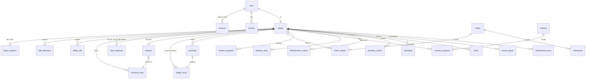

# Data model

PostgreSQL 18 holds everything that must survive. Valkey holds only state that can be rebuilt (presence, queue, seats, parties and lobbies, room registry, rate limits, tickets, abandon cooldowns).

Balance data (weapons, zombies, skills, missions, prices, drop tables) is **not** in these tables. It lives in versioned, validated files in `packages/game-data`; the database stores only ids that point into it (`item_id`, `mission_id`, …) plus the admin panel's edits as new versions (`game_data_version`).

## Entity-relationship diagram

## Tables

Conventions: `id` columns are UUIDv7 (`uuidv7()` is built into PostgreSQL 18) unless stated; timestamps are `timestamptz`; every table has `created_at`. `citext` is used for case-insensitive names. Money-like values are `bigint`.

### Accounts (managed by Better Auth through its Prisma adapter)

| Table | Columns | Notes |
|---|---|---|
| `user` | `id`, `email`, `email_verified`, `name`, `image` (always null), `created_at`, `updated_at` | `name` is set to the player name |
| `account` | `id`, `user_id` → user, `provider_id` (`github`/`google`), `account_id` (provider's user id), token columns (left null after sign-in), `created_at` | unique (`provider_id`, `account_id`) |
| `session` | `id`, `user_id`, `token` (unique), `expires_at`, `ip_address`, `user_agent` | 30-day rolling sessions |
| `verification` | Better Auth's OAuth state table | short-lived |

### Player and progression

| Table | Columns | Constraints and notes |
|---|---|---|
| `player` | `user_id` PK → user, `player_name` citext, `avatar_style`, `avatar_seed`, `avatar_options` jsonb, `active_class` (`assault`/`medic`/`heavy`), `salvage` bigint, `title_id`, `banner_id`, `is_admin` bool | `player_name` unique, 3–16 chars, filter-checked in the API; `salvage >= 0`; the balance is a cache of the ledger (checked by a nightly job and in tests) |
| `class_progress` | `player_id`, `class`, `xp` bigint | PK (`player_id`, `class`); three rows created with the player. Level and skill points are derived from the XP total and the game data, so a curve change never needs a migration |
| `skill_allocation` | `player_id`, `class`, `node_id`, `rank` | PK (`player_id`, `class`, `node_id`); prerequisites checked against game data |
| `ability_slot` | `player_id`, `class`, `slot` (1–3), `ability_id` | PK (`player_id`, `class`, `slot`) |
| `inventory_item` | `player_id`, `item_id`, `upgrade_level` int (0–20), `perks` text[] (one chosen perk per perk level reached), `source` (`starter`/`shop`/`drop`), `acquired_at` | **PK (`player_id`, `item_id`)**: one copy of each item, no rarity. The item's slot comes from game data |
| `item_duplicate` | `id`, `player_id`, `item_id`, `match_id`, `found_at` | A found copy of something already owned; its only action is "discard for currency". Until match records exist, `match_id` holds the id of the room the item was found in |
| `loadout` | `player_id` PK, `main_1`, `main_2`, `pistol`, `armour_head`, `armour_torso`, `armour_vest`, `armour_legs`, `armour_feet`, `utility_1`, `utility_2` (item ids) | Each is a foreign key to (`player_id`, `item_id`) in `inventory_item`, so only owned items can be equipped; shared across classes; `main_1 <> main_2`; slots (and each armour piece's place) are checked against game data by the API |
| `mission_progress` | `player_id`, `mission_id`, `difficulty` enum (`recruit`/`veteran`/`nightmare`/`apocalypse`), `completions` int, `best_time_ms` int, `best_score` bigint, `mastery` enum (`none`/`bronze`/`silver`/`gold`), `updated_at` | PK (`player_id`, `mission_id`, `difficulty`). Checks: `completions >= 0`, `best_time_ms > 0`, `best_score >= 0`, and `best_time_ms` is null exactly when there are no completions. Written from signed mission results (successful ones only): completions count up, best time, best score and mastery keep the best. These rows also decide which campaign missions a player has opened: a mission opens once the one before it (in the campaign order in game data) has a row with `completions > 0` |
| `bestiary_entry` | `player_id`, `zombie_type`, `first_kill_at`, `kills` bigint, `mutations_seen` text[] | PK (`player_id`, `zombie_type`) |
| `achievement_unlock` | `player_id`, `achievement_id`, `unlocked_at` | PK both ids |
| `cosmetic_unlock` | `player_id`, `cosmetic_id`, `source`, `unlocked_at` | PK both ids |

### Economy

| Table | Columns | Constraints and notes |
|---|---|---|
| `ledger_entry` | `id` bigserial, `player_id` uuid, `amount` bigint (signed, never 0), `balance_after` bigint (never negative), `reason` enum (`kill`, `wave`, `objective`, `mission`, `score`, `contract`, `discard`, `purchase`, `upgrade`, `perk`, `respec`, `admin`), `ref_type`, `ref_id`, `grant_key` text, `created_at` | **Append-only**: triggers reject `UPDATE`, `DELETE` and `TRUNCATE`. In production the game connects as `rotline_app`, a role that owns nothing (so it cannot disable the triggers) and has no `UPDATE`, `DELETE` or `TRUNCATE` on `ledger_entry`, `purchase` and `reward_grant`; migrations run as the owner role. **unique (`grant_key`)** makes rewards idempotent. Index (`player_id`, `id`) |
| `purchase` | `id`, `player_id`, `sku`, `price`, `ledger_entry_id` → ledger_entry, `created_at` | One row per shop purchase; written in the same transaction as its ledger row and the item |
| `reward_grant` | `grant_key` PK, `player_id`, `class`, `xp`, `salvage`, `room` (nullable), `items` text[] NOT NULL (at most 32), `result` bool, `created_at` | One row per reward report from a game server. Inserted in the grant's transaction before anything is paid, so a report delivered twice grants nothing the second time. `room`, `items` and `result` record what each report granted from which room, so items are capped and a mission result counted once per player and room across all of that room's reports. Index (`player_id`, `room`) |

Every change to a player's progress, inventory or Salvage runs in one transaction that first locks the player row (`SELECT … FOR NO KEY UPDATE`), so one player's changes run one at a time. A currency change then checks the balance, inserts the ledger row with `balance_after`, updates the player's `salvage`, and applies the item, upgrade or reward. Prices come from the active game-data version, never from the client.

### Matches

| Table | Columns | Notes |
|---|---|---|
| `match` | `id`, `mode` (`campaign`/`survival`/`event`/`range`), `mission_id`, `difficulty`, `modifiers` text[], `game_instance`, `started_at`, `ended_at`, `result` (`success`/`failed`/`abandoned`/`crashed`) | Firing-range sessions are not recorded |
| `match_player` | `match_id`, `player_id`, `class`, `score`, `kills`, `downs`, `revives`, `deaths`, `xp_awarded`, `currency_awarded`, `grant_key` | PK (`match_id`, `player_id`) |
| `checkpoint` | `match_id`, `seq`, `state` jsonb, `created_at` | Last few per match; pruned after the match ends |

### Contracts, events and leaderboards

| Table | Columns | Notes |
|---|---|---|
| `contract` | `id`, `kind` (`daily`/`weekly`/`bounty`), `template_id`, `params` jsonb, `reward`, `starts_at`, `ends_at` | Rotated by a scheduled job on a fixed UTC clock |
| `contract_progress` | `player_id`, `contract_id`, `progress`, `completed_at`, `claimed_at` | PK both ids; progress counted from match events on the server |
| `event_schedule` | `id`, `event_id`, `starts_at`, `ends_at`, `enabled`, `updated_by` | Special events, switched in the admin panel |
| `leaderboard_entry` | `board` (e.g. `survival:<map>:<season>`), `player_id`, `score`, `match_id`, `achieved_at` | PK (`board`, `player_id`); index (`board`, `score desc`) |

### Social

| Table | Columns | Notes |
|---|---|---|
| `friendship` | `player_a`, `player_b`, `status` (`pending`/`accepted`), `requested_by`, `created_at`, `accepted_at` | PK (`player_a`, `player_b`) with `player_a < player_b`, so each pair has one row |
| `block` | `blocker_id`, `blocked_id`, `created_at` | PK both; blocking removes friendship and pending requests |
| `recent_player` | `player_id`, `other_id`, `match_id`, `played_at` | Last 50 per player, pruned on insert |
| `friend_invite_link` | `code` PK, `player_id`, `expires_at`, `uses` | For "add me" links |

### Administration

| Table | Columns | Notes |
|---|---|---|
| `admin_setting` | `key` PK, `value` jsonb, `updated_by`, `updated_at` | e.g. `capacity` = **24** at launch, `capacity_auto_floor`, idle timeouts |
| `game_data_version` | `id`, `kind` (`weapons`, `zombies`, …), `version`, `content` jsonb, `active` bool, `created_by`, `created_at`, `note` | Balance edits from the admin panel are validated with the same Zod schemas as the files, stored as a new version, and activated; full change history kept |
| `audit_log` | `id` bigint, `actor_id`, `action`, `target`, `data` jsonb, `created_at` | Every admin action and every account deletion |

## Account deletion

In one transaction: delete the `user` row, which cascades to `account`, `session`, `player` and every player-owned table above. Ledger, purchase and reward-grant rows are not deleted (they record the economy), but their `player_id` is replaced by a random tombstone id through a single `SECURITY DEFINER` function, the only code path allowed to modify the ledger. `match_player` rows are re-pointed to the same tombstone so other players' match history still adds up. The action is written to `audit_log` without the player name or email.

## Indexes worth noting

- `ledger_entry (player_id, id desc)` for the player's history and the admin ledger lookup.
- `friendship (player_b, status)` for the reverse lookup.
- `inventory_item (player_id)`, `item_duplicate (player_id)`.
- `reward_grant (player_id, room)` for the per-room item cap and result check.
- `contract (kind, starts_at, ends_at)`.
- `leaderboard_entry (board, score desc)`.

## Migration rules

- Generated by `prisma migrate dev` from `schema.prisma`, then read and edited by hand; committed as SQL. Migrations run over a direct database connection; the app connects through the pooler.
- Expand, then contract: add nullable columns or new tables, deploy code that writes both, backfill, then remove the old shape in a later release.
- Never rename a column in one step; never add a `NOT NULL` column without a default in one step.
- A migration that adds a table the game writes grants the app role (`rotline_app`) access to it when that role exists, so it does nothing in local development and CI.
- Every migration is tested in CI from an empty database and from the previous release's schema with seed data.
